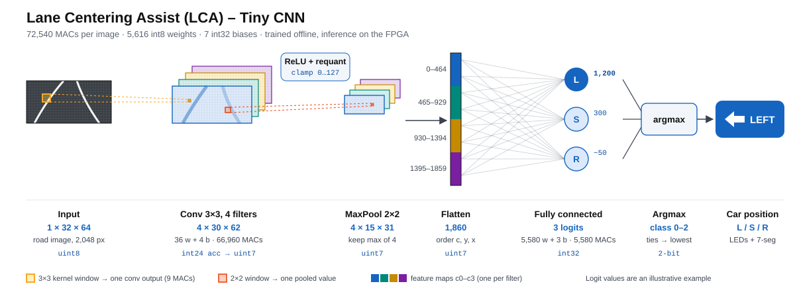
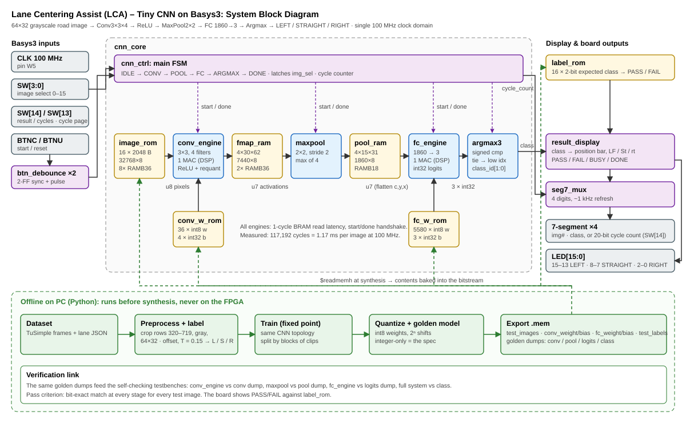

# LCA: Tiny CNN for lane position on a Basys3 FPGA

A small convolutional neural network, written in Verilog, that runs on a Digilent Basys3 board (AMD Artix-7 XC7A35T). It looks at a 64×32 grayscale image of the road ahead and decides where the car is in its lane: **LEFT** of the lane centre, centred (**STRAIGHT**), or **RIGHT** of the centre.

This is the perception step of a Lane Centering Assist (LCA) system. Training happens offline in Python. The FPGA runs **inference only**, with fixed int8 weights and integer arithmetic, and its output matches a Python integer model **bit for bit**. Test images are stored on the chip and selected with the board's switches; the result appears on the LEDs and the seven-segment display.

It was built in 7 days as the final project of a VLSI/FPGA training course. It is a proof-of-concept accelerator, not a production or safety-certified driver-assistance function.



```
Road image (64×32 gray) → Conv 3×3 ×4 → ReLU → MaxPool 2×2 → FC 1,860→3 → Argmax → LEFT / STRAIGHT / RIGHT
```

## Results

All numbers are for build B05, tested on the board.

| Metric | Target | Achieved |
|---|---|---|
| Test accuracy (2,216 TuSimple test images) | ≥ 80% | **83.0%** ✔ |
| RTL vs Python integer model | bit-exact | **identical** on 16/16 board images and 128/128 regression images ✔ |
| Latency per image | ≤ 120,000 cycles | **117,192 cycles = 1.17 ms** at 100 MHz ✔ |
| Clock | 100 MHz, WNS ≥ 0 | **100 MHz**, WNS +0.651 ns ✔ ¹ |
| LUT | ≤ 25% | **429 (2.1%)** ✔ |
| Flip-flops | ≤ 10% | **364 (0.9%)** ✔ |
| Block RAM | ≤ 30% | **12.5 of 50 tiles (25%)** ✔ |
| DSP48 | ≤ 10% | **2 of 90 (2.2%)** ✔ |
| Board demo | ≥ 15/16 images as the model predicts | **16/16** (14/16 also match the true label) ✔ |

¹ For every path inside the FPGA. The board inputs and outputs (switches, buttons, LEDs, seven-segment display) have no input or output delay constraints: they are slow, and the switches and buttons go through 2-flip-flop synchronizers, so they don't limit the clock.

The planning estimate was about 106,000 cycles; 117,192 is the measured count, the same for every image. Where each number comes from:

- accuracy and confusion matrix: [report/test_accuracy.md](report/test_accuracy.md)
- RTL vs Python regression: [report/regression/summary.md](report/regression/summary.md)
- timing and utilization per build: [report/implementation_log.md](report/implementation_log.md) and the Vivado reports in [report/builds/](report/builds/)
- board results: [report/board_test_log.md](report/board_test_log.md)

## Specification in brief

**Classes and labels.** Labels are computed automatically from the [TuSimple](https://github.com/TuSimple/tusimple-benchmark) lane annotations. At image row 670, just ahead of the car, the car's offset from the lane centre is

```
offset = (640 − lane_centre) / (lane_width / 2)        (x = 640 is the car's position)
LEFT if offset < −0.15,  RIGHT if offset > +0.15,  otherwise STRAIGHT
```

The class is the car's position, not a steering command: a car classified LEFT would need to steer right.

**Input.** Each 1280×720 dash-camera frame is cropped to the road (rows 320–719, columns 240–1039), converted to grayscale and resized to 64×32 with OpenCV `INTER_AREA`. Pixels are uint8.

**Network.**

| Layer | Output shape | Parameters | MACs |
|---|---|---|---|
| Conv 3×3, 4 filters, no padding | 4×30×62 | 36 weights + 4 biases | 66,960 |
| ReLU and requantize to 0–127 | 4×30×62 | | |
| MaxPool 2×2, stride 2 | 4×15×31 | | |
| Fully connected | 3 logits | 5,580 weights + 3 biases | 5,580 |
| Argmax (ties go to the lowest index) | class 0, 1 or 2 | | |
| **Total** | | **5.6 KB of int8 weights** | **72,540** |

**Number formats.** Every scale is a power of two, so all rescaling is a bit shift:

- int8 weights, uint8 pixels and int32 biases;
- a 24-bit conv accumulator and a 32-bit FC accumulator;
- after the conv: `clamp((acc + 2^(S1−1)) >> S1, 0, 127)` with `S1 = 9` (round half up, then ReLU and saturation in one step).

**Hardware.** The design runs layer by layer. The conv, max-pool and FC engines each read their input from block RAM and write their output to block RAM, and a controller FSM starts them in turn. The conv and FC engines each have one multiply-accumulate unit, mapped to a DSP48. Single 100 MHz clock. The module tree and memory map are in [hw/README.md](hw/README.md).



To try other network sizes on the Basys3 before writing RTL, open [assets/cnn_fpga_fit_calculator.xlsx](assets/cnn_fpga_fit_calculator.xlsx) in Excel or LibreOffice. Enter the layers and it estimates BRAM, DSPs and cycles; it is pre-filled with this design.

**Board controls.**

| Control | Function |
|---|---|
| `SW[3:0]` | Select one of 16 stored test images |
| `BTNC` | Start inference |
| `BTNU` | Reset |
| `SW[14]` | Display: 0 = result, 1 = cycle count (hex) |
| `SW[13]` | With `SW[14] = 1`: 0 = low 16 bits of the count, 1 = top 4 bits |
| LEDs 15–13 / 8–7 / 2–0 | Position bar: LEFT / STRAIGHT / RIGHT |
| LED 11 / LED 10 | PASS / FAIL: prediction equals / differs from the stored true label |
| LED 4 / LED 3 | DONE / BUSY |
| Seven-segment | Image number, then `LF`, `St` or `rt` |

## How it was verified

1. **Python integer model** ([hw/tools/int_model.py](hw/tools/int_model.py)): the specification. It reads the same `.mem` weight files as the FPGA.
2. **Unit testbenches** for every module (MAC, ReLU/requantize, conv, max-pool, FC, argmax, controller, memories, debounce, display). Each one checks itself and prints `TEST PASSED` or `TEST FAILED`.
3. **Full-core simulation** of all 16 board images, comparing every conv output, pool output, logit and class with the Python model's dumps in `mem/golden/` (written by [hw/tools/export_golden.py](hw/tools/export_golden.py)). `run_tests.tcl` runs all 20 testbenches in one go.
4. **Regression**: 128 random test images through the RTL in simulation, all identical to Python.
5. **Board test**: all 16 images on the Basys3, plus the latency read from the on-board cycle counter.

## Tutorial: build it and run it on a Basys3

No bitstream is included; you build it yourself from the sources.

### What you need

- A **Digilent Basys3** board and a micro-USB cable.
- **AMD Vivado 2026.1**. The free Standard edition supports the Basys3's chip (`xc7a35tcpg236-1`).
- **Python 3** on your `PATH` as `python`. The test and build scripts use it to read `mem/quant_params.txt`. No extra packages are needed for this.
- `git`, to clone the repository.

The commands below are for PowerShell on Windows. On Linux, run `vivado` with the same arguments.

### Step 1: get the code

```powershell
git clone https://github.com/jibrilzhillan/lca-tiny-cnn-basys3.git
cd lca-tiny-cnn-basys3
$v = "C:\path\to\Vivado\2026.1\bin\vivado.bat"     # change to your Vivado install
```

Run every command from the repo root.

### Step 2 (optional): run the testbenches

```powershell
& $v -mode batch -nojournal -nolog -notrace -source hw/vivado/run_tests.tcl
```

This simulates every module in XSim and prints `PASS` or `FAIL` per test, then `RESULT: <n> tests, 0 failures, 0 blocked`. Logs go to `hw/vivado/build/tests/`.

### Step 3: create the Vivado project

```powershell
& $v -mode batch -nojournal -nolog -source hw/vivado/create_project.tcl
```

This creates `hw/vivado/build/lca_tiny_cnn.xpr` with `top_basys3` as the top module, adds all RTL, the constraints and the `.mem` files from `mem/`, and generates the quantization header. Use this script rather than making a project by hand: a project without that header builds without errors but gives wrong results (the board shows `rt` for almost every image).

### Step 4: build the bitstream

```powershell
& $v -mode batch -nojournal -nolog -source hw/vivado/build_bitstream.tcl
```

This runs synthesis, implementation and bitstream generation. At the end it prints the timing (WNS should be positive) and the path of the bitstream, `hw/vivado/build/lca_tiny_cnn.runs/impl_1/top_basys3.bit`. It also copies the timing and utilization reports to a new `report/builds/Bnn_<commit>/` folder.

### Step 5: program the board

1. Set the Basys3's mode jumper **JP1 to JTAG**.
2. Connect the board with the USB cable and switch it on.
3. Run:

```powershell
& $v -mode batch -nojournal -nolog -source hw/vivado/program_board.tcl
```

It prints `Programmed xc7a35t_0 with ...`. You can also open the project in the Vivado GUI and use **Open Hardware Manager → Program Device**.

The design is loaded into the FPGA's configuration memory only, so it is lost when the board is switched off. Run step 5 again after a power cycle.

### Step 6: run the demo

1. Set all switches down. Press **BTNU** (the up button) to reset. The display shows `0 --`.
2. **Choose an image** with switches `SW3`–`SW0` (binary, 0–15). The left digit of the display shows the image number in hex.
3. Press **BTNC** (the centre button) to classify it. The run takes 1.17 ms, so the result appears immediately:
   - the two right digits show `LF`, `St` or `rt` (car left of centre, centred, or right of centre);
   - the matching LEDs light: LEDs 15–13 for LEFT, 8–7 for STRAIGHT, 2–0 for RIGHT;
   - LED 4 (DONE) lights, and LED 11 (PASS) or LED 10 (FAIL) shows whether the prediction equals the image's true label.
4. Repeat with other images. Images `A` and `D` show FAIL: the model gets those two wrong, and the hardware gives exactly the model's answer.
5. **Read the latency:** flip `SW14` up. The display shows the cycle count of the last run in hex, low 16 bits first: `C9C8`. Flip `SW13` up as well to see the top bits, `0001`. Together that is `0x1C9C8` = 117,192 clock cycles. Flip both down to return to the result.

### Troubleshooting

| Symptom | Fix |
|---|---|
| `run_tests.tcl` reports `BLOCKED` or `FAIL` before simulating | Check that `python` runs Python 3 and that every file in `mem/` is present. The log for each test is under `hw/vivado/build/tests/` |
| The board shows `rt` on almost every image | The project wasn't made by `create_project.tcl`, or its top was changed in the GUI. Recreate it with step 3 and rebuild |
| `program_board.tcl`: "No xc7a35t found" | Board off, JP1 not on JTAG, or the USB cable is charge-only |
| `program_board.tcl`: "No bitstream" | Run step 4 first |

More commands (a board-only build with a stub core, single-module synthesis, using the GUI) are in [hw/README.md](hw/README.md) and [hw/vivado/vivado-cmds.md](hw/vivado/vivado-cmds.md).

## Reproducing the accuracy

The TuSimple images are not included in this repository (the dataset's licence doesn't allow redistribution). The 16 board images are kept, downscaled to 64×32, in `mem/test_images.mem`.

To rebuild the test set and check the 83.0%:

1. Install Python 3 with `pip install -r requirements.txt`, plus `pip install opencv-python` (the preprocessing uses OpenCV).
2. Download TuSimple: `python sw/dldataset.py` (uses `kagglehub`; you need a Kaggle account).
3. Preprocess the test set: set `DATA_ROOT` and `OUTPUT_FILE` at the top of `sw/preprocess_tusimple.py`, then run it. It writes `tusimple_preprocessed_test.npz`.
4. Evaluate: `python hw/tools/eval_test_set.py --dataset path/to/tusimple_preprocessed_test.npz`.

## Repository layout

```
README.md, DESIGN_DECISIONS.md, LICENSE
assets/         CNN and system diagrams, FPGA fit calculator (spreadsheet)
hw/
├── rtl/        synthesizable Verilog: include/, lib/ (ROM, RAM, debounce), cnn/ (conv/, classifier/), board/
├── tb/         self-checking testbenches, mirroring rtl/, plus common/ and system/
├── constr/     basys3.xdc
├── tools/      Python integer model, regression and accuracy scripts
└── vivado/     Tcl scripts to create, build, program and test (the project folder is generated)
mem/            weights, biases, quantization parameters, 16 board images and their labels;
                golden/ holds the Python model's conv, pool, logit and class outputs for those images
sw/             dataset download, preprocessing, board-image .mem export
└── lane_model/ the trained model (float .pt), its int8 export (.npz, same weights as mem/), validation metrics
report/         test accuracy, build log, board test log, regression results, archived Vivado reports
study-material/ short explainers: fixed-point quantization, Tcl, Basys3 resources, reading Vivado reports
```

## Credits

Built by a five-person team as the final project of a VLSI/FPGA training course:

| Team member | Work |
|---|---|
| [@husnasalsa](https://github.com/husnasalsa) | Dataset, labelling, model training and quantization, weight export |
| [@cchessyy](https://github.com/cchessyy) | Convolution engine: MAC, address generator, ReLU and requantization, DSP mapping |
| [@ashybdsd](https://github.com/ashybdsd) | Classifier: max-pool, fully connected layer, argmax |
| [@abiyyusigit](https://github.com/abiyyusigit) | Memories, controller FSM, core integration, testbench framework |
| [@jibrilzhillan](https://github.com/jibrilzhillan) | Project lead: board top level and display, Vivado flow, timing closure, board bring-up, Python verification tools |

Training and test images derived from the [TuSimple lane detection benchmark](https://github.com/TuSimple/tusimple-benchmark). Data files © the original authors.

## Licence

The code is released under the MIT licence (see [LICENSE](LICENSE)). The TuSimple-derived board images in `mem/test_images.mem` remain under TuSimple's terms.
